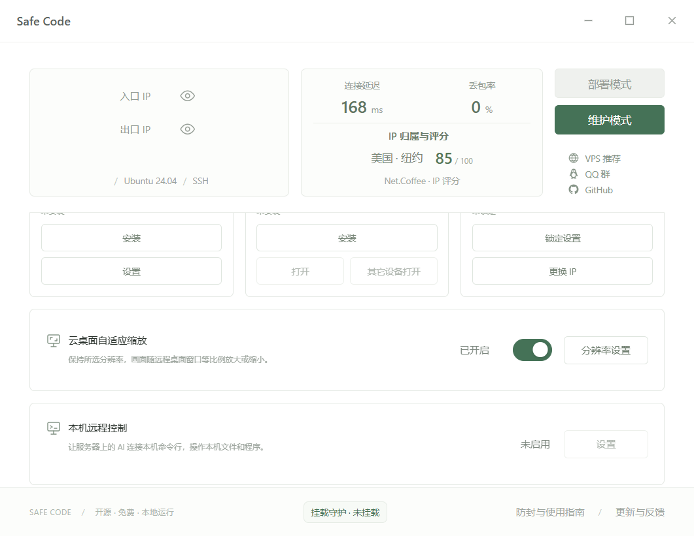

# Windows 云桌面固定分辨率缩放

维护模式新增“云桌面自适应缩放”开关。开启后，拖动、最大化或还原远程桌面窗口时，整个远端画面按比例适应客户区；最初选择的云端分辨率保持不变。例如选择 1920×1080 后，即使本机将画面放大到 2560×1440，远端仍为 1920×1080，应用布局不因窗口变化而重排。

没有保存设置时默认关闭。关闭时沿用原来的缩小显示方式，不超过原分辨率放大；开关即时作用于当前打开的远程桌面，并保存到本机 `desktop-scaling.json`，后续打开桌面时继续使用。分辨率选择仍由原有“分辨率设置”负责。

窗口与远端画面比例不同时会留边，避免拉伸或裁切。本机放大不会增加远端像素，因此放大后的文字可能稍软。此开关使用 Windows RDP ActiveX；macOS 不显示该卡片。



## 实现

- `RdpDisplayScaling` 计算居中、完整显示的控件边界。窗口大小和 DPI 变化只触发布局计算，不调用 `UpdateSessionDisplaySettings`，不自动重连。
- 保持 `SmartSizing=true`，通过 `IMsRdpExtendedSettings` 在连接前设置 `EnableZoom=true`，允许本机画面超过远端尺寸。开关关闭时由控件边界限制放大；后续开启无需重新连接。
- 不使用与 SmartSizing 互斥的 `ZoomLevel`。Windows 组件不支持 EnableZoom 时，开启功能会给出可操作提示，关闭后仍可连接。
- `DesktopScalingPreferences` 独立保存开关。写入失败时恢复原开关状态；不改写 `desktop-resolution.json`。
- UI 单独放在 `desktop-scaling.js` / `desktop-scaling.css`。打包列表包含两个资源，macOS 初始化会直接跳过此功能。

接口依据：[Microsoft IMsRdpExtendedSettings::Property](https://learn.microsoft.com/windows/win32/termserv/imsrdpextendedsettings-property)。

## 可复现检查

在具备 .NET 10 SDK、Windows RDP 组件的 Windows 机器上，从仓库根目录运行：

```powershell
dotnet build src/SafeCode.Desktop/SafeCode.Desktop.csproj -c Release
dotnet run --project tools/SafeCode.Scaling.Verify -c Release -- .local/scaling-check
```

验证 32 组显示尺寸、居中及完整画面、开关保存/重读、缺失或损坏设置的默认行为，以及 RDP COM 能力。程序不读取真实登录凭据、不连接服务器、不操作现有 Safe Code 进程。

具备 WebView2 Runtime 的机器还可以检查界面：

```powershell
dotnet run --project tools/SafeCode.Scaling.Verify -c Release -- .local/scaling-ui --ui .
```

界面验证使用本地页面和模拟 native 接口，拦截外网请求。覆盖开关读写、保存失败恢复、重复点击保护、读取失败、原有分辨率按钮、macOS 隐藏，以及 1060/580/360 宽度。结果和仅含示例数据的截图写入指定目录。

## 远端人工验收

在自己的测试服务器打开桌面，记录当前分辨率，再按下列流程验证：

1. 选择 1920×1080，开启缩放。
2. 缩小、最大化、还原窗口，再改成竖长窗口；云端显示设置中的分辨率应始终为 1920×1080。
3. 在最大化状态关闭/开启缩放，画面应即时切换，服务器连接保持。
4. 在画面边缘和中部操作，确认指针定位正确；检查输入、剪贴板等已有功能。
5. 关闭再打开客户端，确认开关持久保存。另行主动更改分辨率，确认原有分辨率功能仍可使用。

本次在 Windows 与 Ubuntu/xrdp 桌面上，已实测缩小、最大化、竖长窗口、还原、关闭/重新开启：远端均保持 1920×1080，最大化后本机画面为 2560×1440，两处指针坐标映射正确。多显示器切换、不同 Windows 构建和远端系统仍建议由维护者补充验证。
